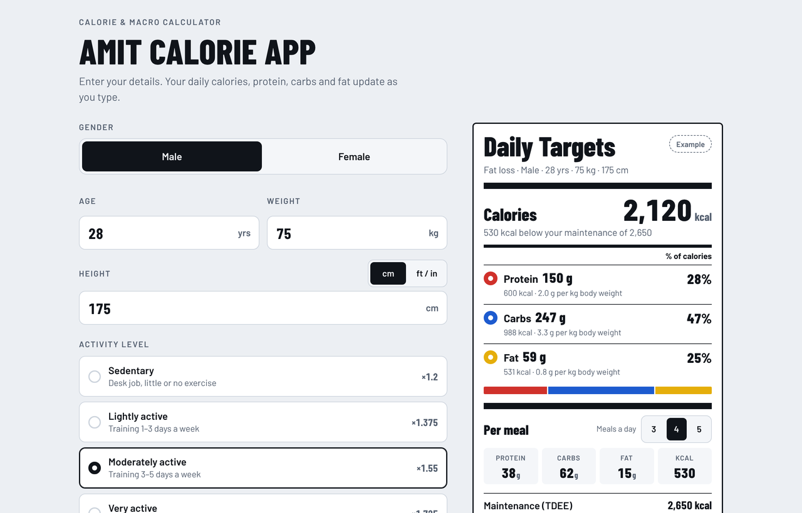
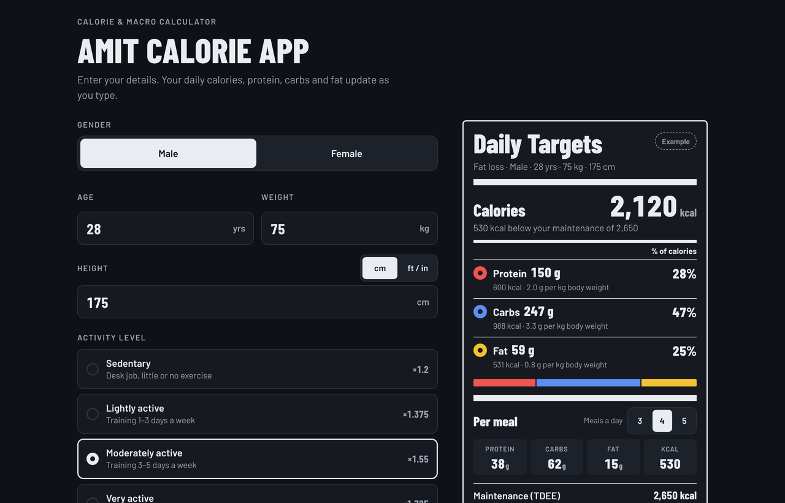
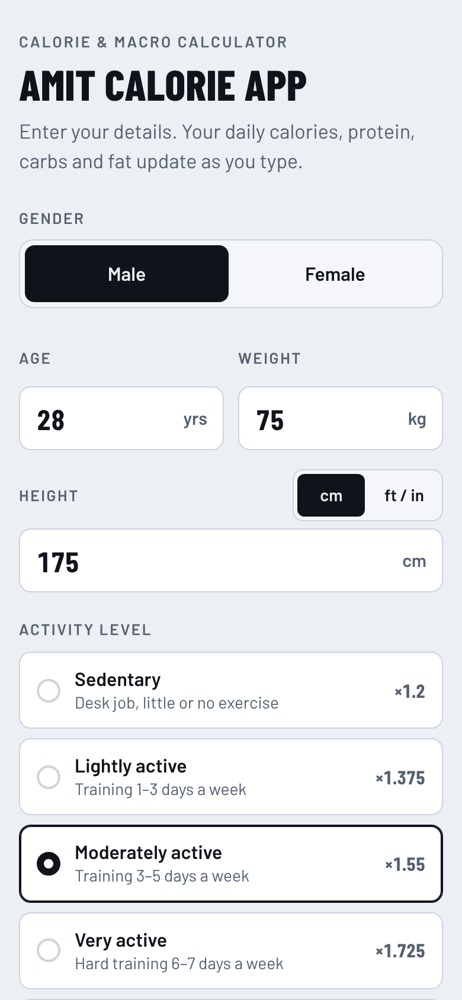

# Calorie & Macro Calculator

A daily calorie and macro calculator that I use with my personal-training clients. Enter age, weight, height, activity level and goal, and it gives daily calories, protein, carbs and fat, plus a per-meal split. It updates as you type, installs on a phone like a native app and works offline.

**[Live app →](https://coach-who-codes.github.io/calorie-macro-calculator/)**




## Why I built it

Clients kept asking me "how much should I eat?", and I was doing the same maths by hand for each of them. Generic online calculators either hide the formula or set protein targets that don't make sense for someone who lifts. This one uses the numbers I actually coach with, shows the working, and reads like a nutrition label, so clients understand it at a glance.

## Features

- **Instant results:** calories, protein, carbs and fat recalculate on every keystroke, with no submit button
- **Nutrition-label layout:** macro colours follow gym bumper plates (red, blue, yellow)
- **Per-meal split** for 3, 4 or 5 meals a day
- **Metric and imperial:** height in cm or ft/in
- **Validation:** clear inline errors for impossible values instead of silently wrong numbers
- **Remembers the last entries** on that device
- **Installable PWA:** manifest, icons and a service worker for offline use
- **Light and dark mode**, mobile-first and keyboard accessible

<p align="center">
  
  &nbsp;
  
</p>

## How it calculates

1. **BMR** (Mifflin-St Jeor): `10 × kg + 6.25 × cm − 5 × age + 5` for men, `− 161` for women
2. **Maintenance (TDEE)** = BMR × activity factor (1.2 / 1.375 / 1.55 / 1.725 / 1.9)
3. **Goal:** fat loss −20%, maintenance ±0, muscle gain +10%. Fat loss never goes below 1,500 kcal for men or 1,200 kcal for women.
4. **Protein:** 2.0 / 1.6 / 1.8 g per kg for fat loss / maintenance / muscle gain. Above a BMI of 27 it uses the weight at BMI 27 for that height, so targets stay realistic.
5. **Fat:** 25% of calories (30% at maintenance), and never under 0.6 g per kg
6. **Carbs:** whatever calories are left

All of these are constants at the top of the main `<script>` in `index.html` (`ACTIVITY`, `GOALS`, `MIN_CUT_KCAL`, `PROTEIN_BMI_CAP`, `MIN_FAT_PER_KG`), so they're easy to adjust.

## Project structure

```
├── index.html            # markup, styles and logic in one file, no build step
├── manifest.webmanifest  # app name, colours, icons
├── sw.js                 # offline cache
└── icons/
```

## Run it locally

```bash
git clone https://github.com/coach-who-codes/calorie-macro-calculator.git
cd calorie-macro-calculator
npx serve .
```

To install it on a phone, open the live link. On Android, use **⋮ → Install app**. On iPhone, use **Share → Add to Home Screen**.

> These are estimates to start from. Adjust them based on weekly weigh-ins.

## Related projects

- [LiftLog](https://github.com/coach-who-codes/workout-tracker): workout tracker with PR detection
- [GymDesk](https://github.com/coach-who-codes/gym-manager-dashboard): gym membership and renewals dashboard
